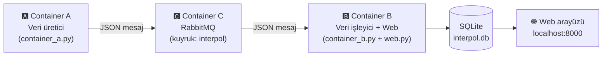

# Interpol Kırmızı Bülten İzleme Sistemi 🚨

Interpol'ün kırmızı bülten (red notice) listesini belirli aralıklarla çeken, bir mesaj kuyruğu üzerinden işleyen, veritabanına kaydeden ve **daha önce kaydedilmiş bir kayıt değiştiğinde** web arayüzünde alarm gösteren, Docker üzerinde çalışan bir veri hattı (pipeline) projesi.

TURK.Ai staj görevi kapsamında geliştirilmiştir.

---

## 🗺️ Mimari




| Container | Rolü | Ne yapar? |
|---|---|---|
| 🅰️ **A** (`container_a`) | Producer (üretici) | Interpol API'sinden kişileri çekmeyi dener (erişilemezse örnek veriyi kullanır), her birini JSON mesajı olarak kuyruğa gönderir. Bunu `KONTROL_ARALIGI` saniyede bir tekrarlar. |
| 🅲 **C** (`rabbitmq`) | Broker (aracı) | Mesajları `interpol` kuyruğunda tutar ve alıcıya iletir. Alıcı kapalıysa mesajlar kaybolmaz, kuyrukta bekler. |
| 🅱️ **B** (`container_b`) | Consumer (tüketici) | Kuyruktan gelen her kişiyi veritabanıyla karşılaştırır, sonucu kaydeder ve HTML sayfasında gösterir. |

### Değişiklik tespiti ve alarm

Container B, gelen her kişi için `entity_id` (bülten numarası) ile veritabanına bakar:

| Durum | Ne olur? |
|---|---|
| 🆕 Kişi veritabanında yok | Kaydedilir. `ilk_gorulme` ve `son_degisiklik` alanlarına aynı zaman yazılır. |
| ✅ Kişi var, bilgiler aynı | Hiçbir şey değişmez. |
| 🚨 Kişi var, bilgiler farklı | Kayıt güncellenir, `son_degisiklik` alanına güncelleme zamanı yazılır. |

Web sayfası, `ilk_gorulme` ile `son_degisiklik` değerleri **farklı** olan satırları kırmızı renkle gösterir. Yani kırmızı satır = *"kaydedildikten sonra en az bir kez değişmiş kayıt"* 🔴

---

## 📁 Dosya yapısı

```
interpol_gorevi/
├── container_a.py       # 🅰️ Producer: veriyi çeker, kuyruğa gönderir (periyodik)
├── container_b.py       # 🅱️ Consumer: kuyruğu dinler, veritabanına işler
├── web.py               # 🌐 FastAPI web arayüzü (tablo + kırmızı alarm satırları)
├── kaynak.py            # 📂 OrnekKaynak / InterpolKaynak: kişi listesini üretir
├── kuyruk.py            # 📮 Kuyruk sınıfı: RabbitMQ'ya gönderme / dinleme
├── veritabani.py        # 🗄️ Veritabani sınıfı: SQLite kayıt ve değişiklik kontrolü
├── test_veritabani.py   # 🧪 Birim testleri (unittest)
├── ornek_veri.json      # 📄 Interpol API cevabının örnek kopyası
├── requirements.txt     # 📋 Python bağımlılıkları
├── Dockerfile           # 🐳 Container A ve B için ortak imaj tarifi
└── docker-compose.yml   # 🎼 Üç container'ı birlikte çalıştıran yapılandırma
```

### Sınıflar (OOP)

| Sınıf | Dosya | Görevi |
|---|---|---|
| `InterpolKaynak` | `kaynak.py` | `kisileri_getir()` ile kişileri gerçek Interpol API'sinden çekmeyi dener; erişilemezse yedek kaynağa (`OrnekKaynak`) geçer. |
| `OrnekKaynak` | `kaynak.py` | `kisileri_getir()` ile kişi listesini `ornek_veri.json` dosyasından okur. |
| `Kuyruk` | `kuyruk.py` | RabbitMQ bağlantısını kurar. `gonder()` sözlüğü JSON'a çevirip kuyruğa atar, `dinle()` gelen JSON'u sözlüğe çevirip verilen fonksiyona iletir. |
| `Veritabani` | `veritabani.py` | Tabloyu oluşturur. `kisi_kontrol()` bir kişiyi kontrol edip `🆕 YENİ`, `✅ Değişmedi` ya da `🚨 ALARM` sonucunu döndürür. |

---

## 🚀 Çalıştırma

### Gereksinim

- [Docker Desktop](https://docs.docker.com/desktop/) (Docker Compose dahil)

### Başlatma


İlk çalıştırmada imajlar indirildiği için 1–3 dakika sürebilir. RabbitMQ hazır olduğunda (healthcheck) Container A ve B otomatik olarak başlar.

### Arayüzler

| Adres | Ne var? |
|---|---|
| http://localhost:8000 | 🌐 Kırmızı bülten tablosu |
| http://localhost:15672 | 🐇 RabbitMQ yönetim paneli (kullanıcı: `guest`, şifre: `guest`) |

### Durdurma

```bash
docker compose down
```

Veritabanı `db_data` adlı Docker volume'unda tutulur; container'lar silinse de kayıtlar korunur. Tamamen sıfırlamak için:

```bash
docker compose down -v
```

---

## ⚙️ Ayarlar (ortam değişkenleri)

Tüm ayarlar `os.getenv` ile ortam değişkenlerinden okunur. Değer verilmezse varsayılan kullanılır. Docker ortamında değerler `docker-compose.yml` içinde tanımlıdır.

| Değişken | Varsayılan | Kullanan | Açıklama |
|---|---|---|---|
| `RABBIT_HOST` | `localhost` | A, B | RabbitMQ adresi (Docker'da `rabbitmq`) |
| `KUYRUK_ADI` | `interpol` | A, B | Kullanılan kuyruğun adı |
| `VERI_DOSYASI` | `ornek_veri.json` | A | API'ye erişilemezse okunacak yedek veri dosyası |
| `KONTROL_ARALIGI` | `30` | A | Veri çekme aralığı (saniye) |
| `DB_DOSYASI` | `interpol.db` | B | SQLite veritabanı dosyası |
| `TZ` | – | A, B | Saat dilimi (`Europe/Istanbul`) |

---

## 🧪 Alarmı test etmek

1. Sistemi başlatın: `docker compose up --build`
2. `ornek_veri.json` dosyasında bir kişinin `date_of_birth` değerini değiştirip kaydedin, ardından sistemi yeniden başlatın: `Ctrl + C` → `docker compose up --build`
   (Veritabanı volume'da korunduğu için eski kayıt hatırlanır.)
3. En fazla `KONTROL_ARALIGI` saniye içinde terminalde `🚨 ALARM` satırı görünür.
4. http://localhost:8000 sayfası her 10 saniyede kendini yeniler: değişen kişinin satırı kırmızıya döner.

### Birim testleri

```bash
python -m unittest test_veritabani.py
```

Testler `Veritabani` sınıfının üç durumunu (🆕 yeni, ✅ değişmedi, 🚨 alarm) ve örnek verinin okunmasını kontrol eder. Geçici, hafızada çalışan bir veritabanı (`:memory:`) kullanır; gerçek veriye dokunmaz.

---

## 📝 Notlar

**Veri kaynağı hakkında:** Interpol'ün herkese açık API'si (`ws-public.interpol.int/notices/v1/red`) bot korumasıyla (Akamai) korunmaktadır ve tarayıcı dışı isteklere `403 Access Denied` döndürmektedir. Bu korumayı aşmaya çalışmak yerine, API'nin tarayıcıdan alınan cevabı `ornek_veri.json` olarak kaydedilmiştir. Dosyanın yapısı gerçek API cevabıyla birebir aynıdır (`_embedded.notices[...]`).

Container A her turda önce `InterpolKaynak` ile gerçek API'den veri çekmeyi dener; erişim engellenirse (403) uyarı yazarak otomatik olarak `OrnekKaynak` ile örnek veriye geçer. Bot koruması aşılmaya çalışılmaz. İki sınıf da aynı `kisileri_getir()` metoduna sahip olduğu için erişim açıldığında kodda değişiklik gerekmez. Kuyruk, veritabanı ve web katmanları veri kaynağından bağımsızdır.

**Neden aynı container'da iki süreç?** Görev tanımına uygun olarak Container B hem kuyruğu dinler hem de web sayfasını sunar. Bu nedenle `container_b` içinde `container_b.py` (consumer) ve `uvicorn web:app` (web sunucusu) birlikte çalışır ve aynı SQLite dosyasını kullanır.

---

## 🛠️ Kullanılan teknolojiler

- **Python 3.11**
- **RabbitMQ** + `pika` (mesaj kuyruğu)
- **SQLite** (`sqlite3`, veritabanı)
- **FastAPI** + `uvicorn` (web arayüzü)
- **Docker** + **Docker Compose**

---

## 👤 Geliştiren

**İnan Deniz Türk**, Hacettepe Üniversitesi Fizik Mühendisliği
GitHub: [inandenizturk](https://github.com/inandenizturk)
